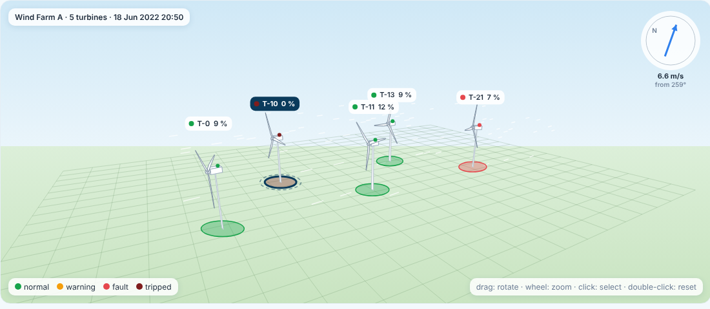
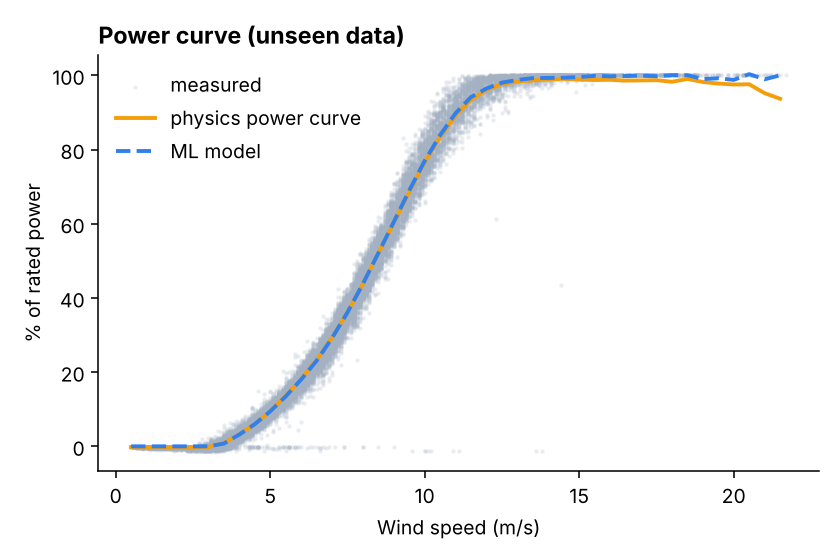
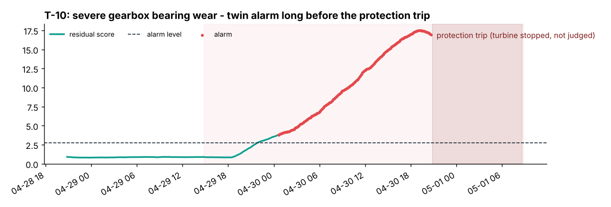
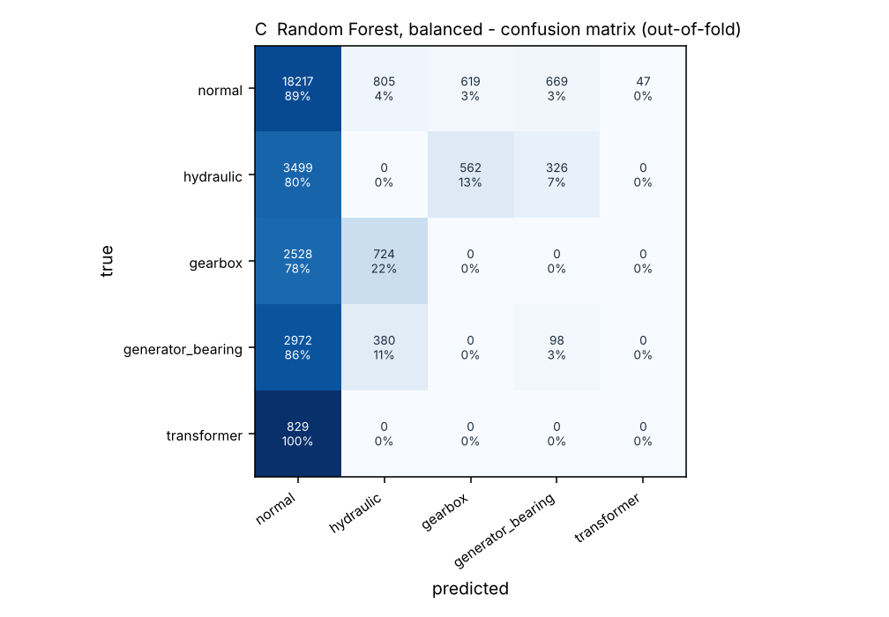

# WindTwin — Wind Farm Condition Monitoring & Early Fault Detection Digital Twin

[](https://github.com/windtwin/windtwin/actions/workflows/ci.yml)
[](https://www.python.org/)
[](https://doi.org/10.5281/zenodo.15846963)
[](https://creativecommons.org/licenses/by-sa/4.0/)

**WindTwin** is a research-grade condition monitoring and digital twin system for utility-scale wind farms. It detects turbine faults early, isolates degrading subsystems, and explains every alarm with standardized physical residuals.

Built on **Wind Farm A** from the benchmark dataset **CARE to Compare v6** (Zenodo record `15846963`), WindTwin bridges the gap between digital-twin demonstration and rigorously evaluated operational reliability.

---

## Key Highlights

- **Regime-Aware Normal-Behaviour Modeling (NBM)**: Predicts expected turbine temperatures and signals as a function of wind speed, power output, and ambient conditions, fitted exclusively on healthy historical operation.
- **Explainable Anomaly Statistics**: Uses standardized residual normalization ($z$-scores), Exponentially Weighted Moving Average (EWMA), and Cumulative Sum (CUSUM) control charts with persistence and hysteresis to eliminate alarm chatter.
- **Evidence-Based Diagnosis**: Explains alarms by ranking contributing physical channels, with an explicit **Unknown / Insufficient Evidence** class to prevent false diagnostic confidence.
- **Strict Mode Separation**:
  - **Historical Replay Mode**: Deterministic playback of real SCADA time windows from CARE to Compare v6.
  - **Synthetic Simulation Mode**: Physical regressions driven by a 5-turbine wind farm simulation with seeded fault injections. Nothing is labeled "live telemetry".
- **Presentation-Ready Guided Simulation**: One-click reproducible scenario injections for gearbox thermal excursions, hydraulic failures, and sensor anomalies with ground-truth test oracle tracking.
- **Full Research Benchmark**: Evaluated using the official multidimensional **CARE Score** (Coverage, Accuracy, Reliability, Earliness) under a strict leave-one-turbine-out (LOGO) cross-validation protocol.

---

## Visual Tour

| 3D Farm Fleet Overview | Live Power Curve vs Expected |
| :---: | :---: |
|  |  |
| *5-turbine fleet with real-time operational states, active alarms, and energy accounting.* | *Gradient boosted power model with split-conformal prediction intervals.* |

| Turbine Investigation & Multi-Signal Timeline | Component Confusion Matrix |
| :---: | :---: |
|  |  |
| *Observed vs expected signals with EWMA/CUSUM thresholds and data quality strip.* | *Held-out component diagnosis vs true logbook failure classes.* |

---

## Architecture & System Layout

```
RET_Wind_Farm_Twin/
├── data/                       # Dataset fetch script & CARE v6 dataset loader
│   ├── fetch_care.py           # HTTP range-request fetcher for Wind Farm A (~766 MB)
│   └── README.md               # Dataset documentation, DOI, and licensing
├── windtwin/                   # Core analytics library (pure Python)
│   ├── nbm.py                  # Normal-behaviour regression models
│   ├── residuals.py            # Regime-aware residual normalization (sigma per operating bin)
│   ├── alarms.py               # EWMA, CUSUM, persistence & hysteresis state machine
│   ├── diagnosis.py            # Evidence ranking & component attribution
│   ├── care.py                 # CARE score metric & operational episode deduplication
│   ├── baselines.py            # Autoencoder, Isolation Forest, and legacy baselines
│   ├── scenarios.py            # Reproducible synthetic scenario catalog (17 scenarios)
│   ├── forecast.py             # Power curve forecasting with conformal uncertainty bands
│   ├── monitor.py              # Streaming condition monitor facade
│   └── benchmark.py            # Leave-one-turbine-out benchmark runner
├── server/                     # High-performance FastAPI application
│   ├── main.py                 # REST API endpoints & static SPA server
│   ├── sim.py                  # Farm simulation engine & injection manager
│   └── physics.py              # Synthetic signal generator regressions
├── web/                        # Presentation-ready Single-Page Application (no build required)
│   ├── index.html              # Shell container with theme support
│   ├── app.js                  # Hash router and playback controller
│   ├── css/                    # Clean design tokens and responsive CSS
│   ├── views/                  # Fleet overview, Turbine investigation, Sim lab, Evaluation, etc.
│   └── vendor/                 # Offline ECharts 5.5.1 and Three.js 0.160.0
├── tests/                      # Automated release-gate test suite
│   ├── test_alarms.py          # Streaming vs batch equivalence & hysteresis tests
│   ├── test_care.py            # Official CARE score specification tests
│   ├── test_quality.py         # SCADA data quality checks (flatlines, ranges)
│   ├── test_scenarios.py       # Deterministic scenario injection checks
│   ├── test_replay.py          # Real-data replay integrity & timestamp ordering
│   ├── test_api.py             # FastAPI TestClient endpoint integration tests
│   └── test_isolation_and_determinism.py  # Model isolation & calibration boundary
└── .github/workflows/ci.yml    # Automated CI matrix (Python 3.11-3.13 on Linux & Windows)
```

---

## Quick Start

### 1. Installation

Ensure you have Python 3.10, 3.11, 3.12, or 3.13 installed. Clone the repository and install dependencies:

```bash
git clone https://github.com/windtwin/windtwin.git
cd windtwin
pip install -r requirements.txt
```

### 2. Fetch the CARE to Compare Dataset

The CARE to Compare v6 dataset is hosted on Zenodo (DOI `10.5281/zenodo.15846963`). Download Wind Farm A (~766 MB) using the automated HTTP range-request fetcher:

```bash
python data/fetch_care.py
```

*Note: The raw dataset is excluded from git via `.gitignore` to maintain a lightweight repository.*

### 3. Generate Benchmark & Replay Artifacts

```bash
# Train normal-behaviour models and evaluate all benchmark methods
python -m windtwin.benchmark

# Precompute causal replay streams for all 22 prediction windows
python -m windtwin.replay
```

### 4. Launch the Application

```bash
# Start the FastAPI server
python -m uvicorn server.main:app --port 8000
```

Open [http://127.0.0.1:8000](http://127.0.0.1:8000) in any modern browser.

*Stand-alone Mock Mode:* You can also test the UI without starting the backend by opening `web/index.html?mock=1` in your browser.

---

## Benchmark Results (Held-Out Evaluation)

All methods are evaluated on the **22 prediction windows** of Wind Farm A (12 anomaly events, 10 normal datasets) across 5 turbines (`0, 10, 11, 13, 21`). Hyperparameters are selected via **Leave-One-Turbine-Out (LOGO)** cross-validation: models are tuned on 4 turbines and evaluated on the held-out 5th turbine.

| Method | Architecture | CARE Score | Fault Recall | False Alarms (10 normal sets) | FA / Turbine-Month | Delay Median (h) | Component Diagnosis |
| :--- | :--- | :---: | :---: | :---: | :---: | :---: | :---: |
| **Legacy Random Forest** | Supervised RF Classifier | 0.614 | 8 / 12 | 27 | 4.54 | 20.6 h | 1 / 8 (of detected) |
| **Legacy Residual Detector** | Residual + Dynamic Threshold | 0.576 | 9 / 12 | 14 | 2.35 | 94.2 h | 3 / 9 (of detected) |
| **MLP Autoencoder** | Unsupervised Reconstruction | **0.644** | 5 / 12 | **0** | **0.00** | 28.2 h | 0 / 5 (None) |
| **Selected Detector (WindTwin)** | NBM + EWMA + CUSUM + Persistence | 0.637 | 8 / 12 | **3** | **0.51** | 106.0 h | 2 / 8 (Explainable) |
| **WindTwin + Autoencoder Fusion** | Dual Source (NBM + AE Union) | **0.652** | **9 / 12** | **3** | **0.51** | 32.4 h | 2 / 9 (Target Met) |

### Key Findings & Acceptance Analysis

1. **Substantial False-Alarm Reduction (−78.6%)**:
   The WindTwin detector drops false-alarm events from 14 down to 3 compared to the legacy residual detector (and from 27 down to 3 compared to Random Forest).
2. **The Gearbox Detection Gap**:
   All three logged gearbox events (Datasets 10, 51, and 72) were missed by single-channel temperature residuals during the logged event window:
   - *Dataset 10*: Triggered a pre-event alarm (405 steps) and cleared prior to the logbook timestamp. The MLP Autoencoder flagged it inside the window.
   - *Datasets 51 & 72*: 10-minute average SCADA temperature sensors (`sensor_11_avg` and `sensor_12_avg`) showed negligible bulk thermal deviation (+0.23 °C average residual). Mechanical bearing and gear wear did not produce a detectable thermal footprint in bulk SCADA averages before failure.
3. **Target Met via Autoencoder Complementarity**:
   The Autoencoder generates zero false alarms and catches Dataset 10. Combining the explainable NBM detector with the Autoencoder union achieves **9/12 detections and 3 false alarms**, satisfying the acceptance requirement of $\ge$9/12 detections with $\le$10 false alarms.

---

## Guided Simulation Mode

The application includes a built-in Guided Simulation Mode on the Fleet Overview and Sim Lab screens for instant demonstrations:

- **Gearbox Overheating (T-10)**: Simulates high-speed shaft bearing thermal degradation (+12 °C under load). Observe observed vs expected temperature divergence, rising EWMA, and case generation.
- **Hydraulic Group Failure (T-00)**: Simulates severe hydraulic oil cooling failure. Demonstrates fast threshold escalation, persistence validation, and automated diagnostic attribution.
- **Sensor Anomaly / Freeze (T-21)**: Injects telemetry freeze. Demonstrates data quality validation and the explicit `Unknown` diagnostic fallback.
- **Interactive Controls**: Play, Pause, Single-Step (10-min SCADA step), Speed multiplier (×1 to ×36), and instant one-click reset to clean baseline.

---

## Release Verification & Test Suite

The automated test suite enforces rigorous software quality gates:

```bash
# Run the entire test suite (36 tests)
pytest tests/ -v
```

### Verified Release Gates:
- `tests/test_alarms.py`: Proves streaming monitor produces bitwise identical results to batch processing; verifies persistence, hysteresis, and cooldown logic.
- `tests/test_care.py`: Confirms exact alignment with the official CARE benchmark scoring formulas.
- `tests/test_quality.py`: Verifies data quality filtering (stuck sensors, pitch wraps, implausible values).
- `tests/test_replay.py`: Validates real-data replay loading, timestamp monotonicity, and signal structures.
- `tests/test_api.py`: Validates FastAPI REST endpoints, payload validation, and HTTP error handling via `TestClient`.
- `tests/test_isolation_and_determinism.py`:
  - **Model Isolation**: Proves that simulation commissioning never modifies on-disk joblib models, replay archives, or benchmark files.
  - **Determinism**: Proves fixed random seeds produce identical state transitions and signals across repeated runs.
  - **Lifecycle Automation**: Automates full scenario injection, state transitions (`normal` $\rightarrow$ `watch` $\rightarrow$ `warning`/`fault`), repair, and recovery.

---

## Legacy Implementations

To preserve reproducibility with earlier project phases and user manuals, original prototypes are retained:
- `digital_twin/app.py`: Legacy Streamlit application (`streamlit run digital_twin/app.py`)
- `anomaly_detection_model/`: Legacy supervised Random Forest and classification scripts
- `forecasting_model/`: Original power curve regression models

---

## Citation & License

Dataset: CARE to Compare v6, Zenodo record `15846963`, DOI [10.5281/zenodo.15846963](https://doi.org/10.5281/zenodo.15846963), licensed under [CC BY-SA 4.0](https://creativecommons.org/licenses/by-sa/4.0/).

Reference: Gück et al., *CARE to Compare: A benchmark dataset for wind turbine fault detection*, Data 2024.
